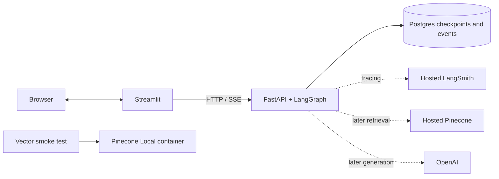

# Comtech assistant infrastructure

An executable foundation for the AI Lead assessment: FastAPI, Streamlit, an async
one-node LangGraph, durable PostgreSQL checkpoints, AG-UI events over SSE, and
LangSmith integration. The graph returns deterministic mock text; it makes no
OpenAI or Pinecone calls. Retrieval and the assessment's security controls are
later milestones. This scaffold is for local development, not public use yet.

## Start on this Windows PC (Podman)

Podman 5.8.2 and its existing Compose provider are supported. Docker Desktop is
not required. Use the existing running Podman machine; if it is stopped, run
`podman machine start`. Do not reset it.

```powershell
Copy-Item .env.example .env  # First setup only; do not overwrite existing keys.
./scripts/preflight.ps1
./scripts/compose.ps1 up --build -d
./scripts/compose.ps1 logs -f api
```

- UI: http://localhost:8501
- API docs: http://localhost:8000/docs
- Health: http://localhost:8000/health/ready
- Postgres: localhost:5433 (development only)

Send any message; watch three progress updates and the mock answer. Send `/fail`
to test failure reporting. The sidebar can load another conversation and replay
a saved run. No provider credentials are needed for this flow.

`podman compose` invokes an external Compose provider. The wrapper forwards all
arguments and chooses base + development configuration explicitly. On Docker
machines set `$env:CONTAINER_ENGINE='docker'`, or run
`docker compose -f compose.yaml -f compose.dev.yaml up --build -d` directly.

```powershell
./scripts/compose.ps1 down      # Keeps Postgres data
./scripts/compose.ps1 up -d     # Reuses checkpoints and events
# Explicit destructive reset of THIS project's stored history:
# ./scripts/compose.ps1 down --volumes
```

Migrations run as a one-shot service before API startup. Source changes reload the
development API. Dependency changes require rebuilding. Runtime images run as a
non-root user without reload; dependencies are pinned in `uv.lock` (Python 3.12).

## Service responsibilities



Postgres is application storage. Pinecone is vector storage. LangSmith is
observability, not a checkpoint database or the live UI transport.

## Persistence and streaming semantics

| API | Behavior |
| --- | --- |
| `POST /api/runs` | `{ "thread_id": "<uuid>", "message": "hello" }`; SSE execution, generated thread ID if omitted |
| `GET /api/runs/{id}` | Status and correlation IDs |
| `GET /api/threads/{id}/runs` | Latest 100 runs |
| `GET /api/threads/{id}/checkpoints` | Latest 30 checkpoints and mock conversation messages |
| `GET /api/runs/{id}/events?after=3` | Read-only recorded events after sequence 3; also accepts `Last-Event-ID: <run-id>:3` |
| `POST /api/runs/{id}/resume` | `{ "checkpoint_id": "..." }`; new execution from a pending checkpoint in that run's thread |

`X-Run-ID`, `X-Thread-ID`, `X-Request-ID`, and `X-Trace-ID` are returned with the
stream. AG-UI JSON is carried in SSE `data`; SSE IDs contain run UUID + sequence.
Events are committed before sending. The UI deduplicates by event ID. Replay reads
currently recorded events and ends; it is not a live subscription to an ongoing run.

LangGraph uses `AsyncPostgresSaver` and synchronous checkpoint durability at step
boundaries. Read-only playback does not call the graph. Checkpoint resume creates a
new run/trace and can re-execute the node. The graph has only one node, so there is
no checkpoint between its individual progress updates. `/fail` will fail again
when resumed because its checkpoint contains the same input.

Execution is request-bound: disconnect cancels it. Interrupted runs retain saved
events/checkpoints; they do not continue automatically in the background. After a
crash, startup marks unfinished run records interrupted. An interrupted event log
can lack a terminal event; consult the run status. Checkpoint writes and event
writes are separate transactions, not an exactly-once execution guarantee.

One API worker/replica is supported. A database advisory lock rejects overlapping
API processes, preventing unsafe startup reconciliation. Stop the old process
before replacing it. Different conversations can execute concurrently; a second
active request for the same conversation gets HTTP 409. State-changing resume
operations also obey that restriction. This lock is not a distributed job system.

## Tests

Install [uv](https://docs.astral.sh/uv/getting-started/installation/) or use
`py -m pip install uv` on this PC, then:

```powershell
py -m uv sync --group ui
./scripts/test.ps1 -q
```

Database tests skip without `TEST_DATABASE_URL`. To run all tests in isolated
containers, including a real HTTP server and Postgres:

```powershell
podman compose -p comtech-tests -f compose.test.yaml up --build --abort-on-container-exit --exit-code-from tests
podman compose -p comtech-tests -f compose.test.yaml down
```

Alternatively set `TEST_DATABASE_URL` to a dedicated local test database and use
`scripts/test.ps1`. Never point it at the demo database: tests create schema and
reconcile run records. Tests verify actual incremental HTTP delivery, history
across application lifetimes, cursor replay, failure, disconnect, and resume.

```powershell
py -m uv run ruff check src ui tests
py -m uv run ruff format --check src ui tests
```

## Pinecone

Pinecone Local is an in-memory emulator distributed as a container image. The
`vector-test` profile starts a 3-dimensional cosine test index and a smoke-test
client. The client seeds known vectors into unique namespaces, verifies search,
metadata filtering and namespace isolation, then removes its fixtures. No OpenAI
embeddings or API keys are used. The emulator loses data when stopped.

```powershell
./scripts/compose.ps1 --profile vector-test up -d pinecone-local
./scripts/compose.ps1 --profile vector-test run --rm vector-test
```

For hosted Starter, set `PINECONE_API_KEY` in `.env`. Index creation is deferred
until embedding dimensions and hybrid strategy are selected. Later set
`PINECONE_INDEX_NAME` and `PINECONE_INDEX_HOST` from that index. To verify only
authentication and list-index access:

```powershell
./scripts/compose.ps1 run --rm --no-deps api python -m comtech.integrations.smoke pinecone-hosted
```

Local tests explicitly choose `PINECONE_MODE=local` and only accept allowlisted
local HTTP hosts. The hosted app uses `PINECONE_MODE=hosted`; production settings
reject emulator mode. Starting the test profile does not redirect the API.

## LangSmith and OpenAI

Set `LANGSMITH_TRACING=true`, `LANGSMITH_API_KEY`, and the endpoint matching your
account region. Default project: `comtech-dev`; use `comtech-demo` for demos.
`LANGSMITH_WORKSPACE_ID` is optional where workspace selection is needed. Sampling
defaults to 1.0. The graph/node trace uses a unique trace ID for each execution and
thread metadata to group conversations. JSON operational logs carry the same IDs.

```powershell
./scripts/compose.ps1 up -d --force-recreate api
./scripts/compose.ps1 run --rm --no-deps api python -m comtech.integrations.smoke langsmith
```

The opt-in LangSmith smoke check submits two successes and one deliberate failure
in one thread, flushes uploads, and verifies the traces can be read. Ordinary tests
disable tracing. Trace upload failures are logged and do not intentionally fail
chat; uploads flush on graceful shutdown. Abrupt process termination can lose
pending telemetry. Only synthetic inputs are appropriate until masking and access
controls are implemented.

Set `OPENAI_API_KEY` for later model work. This opt-in check lists available models
without a generation/embedding request:

```powershell
./scripts/compose.ps1 run --rm --no-deps api python -m comtech.integrations.smoke openai
```

Keep `.env` out of Git. The UI receives only `API_BASE_URL`, not provider keys.
Hosted checks need your keys; no key is included in this repository.

See [deployment preparation](docs/deployment.md), the
[infrastructure plan](docs/plans/development-infrastructure.md), and
[validation results](docs/validation.md).
