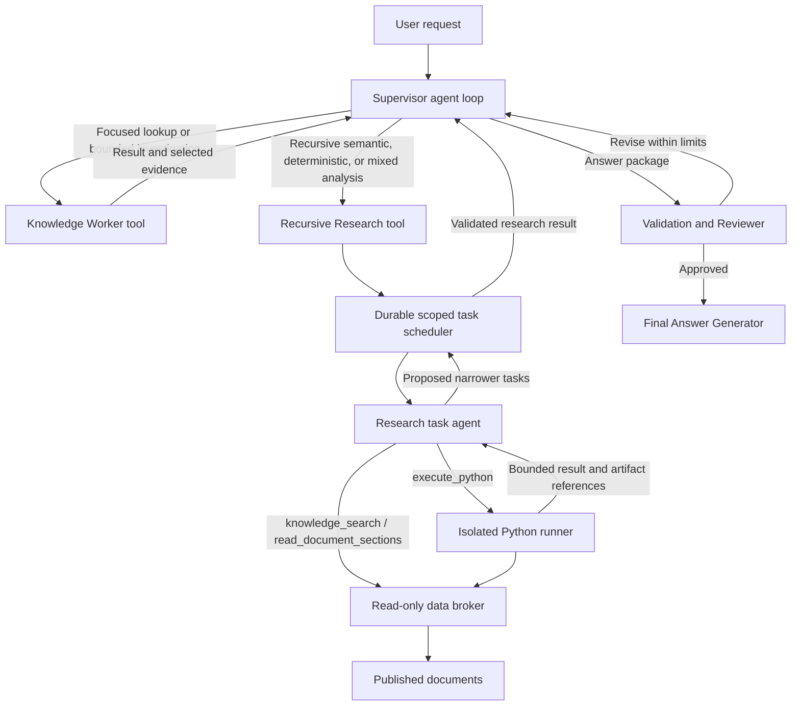

# Comtech implementation specification: recursive research and Python analysis

**Status:** v1.2; R0-R5 implemented and accepted with scripted models on Linux/Podman. R6 wires the opt-in application, private broker/embedding transport, UI lifecycle and retention. The 2026-10-02 complex live baseline completed with 3 passed / 27 failed; hosted acceptance requires remediation. See [live evaluation results](docs/research-evaluation-results-2026-10-02.md) and the execution plan.  
**Updated:** 2026-10-03.  
**Execution plan:** [Phased tasks and executor handoff record](docs/plans/recursive-research-implementation.md). Executors must read this specification and the active phase's referenced sections before implementing its tasks.  
**Target:** Existing Python 3.12 / FastAPI / LangGraph / PostgreSQL application, with Docker or Podman Compose on one Linux host and one application trust domain.

This specification adds a Recursive Research Agent alongside the existing Knowledge Worker. The design routes semantic research that may benefit from decomposition, deterministic analysis, and combinations of both to the new agent. Research proceeds only as far as needed to support the requested answer. The existing Reviewer and Final Answer Generator remain the final answer gate. Research is available to the background Supervisor only when explicitly enabled and its private broker/runner pass readiness; both background and Research default off.

## 1. Decisions and relationship to existing work

Confirmed in the discussion:

- Include a Supervisor tool-calling loop, replacing the original `supervisor_plan -> dispatch -> supervisor_synthesize` orchestration. R1 implements this for ordinary work; pending legacy checkpoints retain their original graph.
- Preserve the supplied spec's execution model: agents perform semantic reasoning and propose children; trusted orchestration admits and schedules them; Python performs brokered retrieval and computation. No direct model SDK or `llm_query` capability is added inside generated Python.
- Research parents and children also have direct `knowledge_search` and `read_document_sections` tools, sharing the existing Knowledge Worker's argument/result contracts. Python and recursive delegation are additional capabilities, not prerequisites for discovery or expansion (D05, clarified 2026-10-01).
- Include durable background research jobs with progress, reconnect, cancellation, and restart recovery. The 30-minute research profile is not an extended HTTP timeout.
- Authorization remains deferred under the existing agreement. User/tenant RBAC, ACL enforcement and field redaction are a future milestone. Source allowlists, execution capabilities and generated-code isolation are required now.

The earlier [enterprise implementation plan](docs/plans/enterprise-agents-implementation.md) records completed work. Its deferral of Python analysis and recursive workers is superseded by the implemented R3-R6 capabilities. The ordinary Knowledge Worker continues to use its existing bounded ReAct loop.

| Concern | Implemented application | Change specified here |
| --- | --- | --- |
| Supervisor | R1: checkpointed tool loop with Knowledge Worker, review submission and version-aware legacy resume | Add Research as a second specialist when its runtime is accepted |
| Knowledge Worker | Five decision cycles; document search/read plus seven MCP tools | Preserve behavior and contracts; usable as the ordinary research tool |
| Recursive research / Python | R3-R5 broker, scoped recursive tasks and restricted Python; R6 opt-in background application wiring | Hosted semantic quality and additional deployment targets still require acceptance |
| Source discovery | Pinecone hybrid top-k search and bounded source reads | Add explicit collection enumeration and coverage contracts for analysis |
| Evidence | Exact source observations; R1 adds tested computation/inheritance contracts and an in-memory registry adapter | Add durable registration and integrate Research result exports with the runtime |
| Persistence | LangGraph checkpoints, background run/events, fenced task queue, shared ledger and conservative call-receipt recovery | Add durable analysis artifact storage and Research continuations |
| Streaming | Legacy streams plus opt-in background execution with durable events and replay-follow delivery | Integrate background UI and Research progress |
| Deployment | API, UI, PostgreSQL, Northstar MCP; optional tracing | Add broker and runner services through an opt-in Compose overlay |

Code is authoritative where older milestone docs still say the application is a mock or does not call MCP. See [agent operation](docs/agents.md), [graph](src/comtech/agents/graph.py), [runtime](src/comtech/agents/runtime.py), [API lifecycle](src/comtech/api/app.py), and [database](src/comtech/db.py).

## 2. Routing and role boundaries

### 2.1 Supervisor capabilities

Expose these conceptual tools through validated typed schemas:

```python
knowledge_worker(task: KnowledgeTask) -> SpecialistResult
recursive_research(task: ResearchTask) -> SpecialistResult
```

`SpecialistResult` is the validated result/evidence envelope described in section 5. Tool execution may suspend a durable graph while a research objective runs. A pending execution is a control record, never an answer or empty successful result. The Supervisor receives the completed or partial result when its continuation runs.

The Supervisor chooses the next objective after seeing prior results, may request independent calls together, and eventually returns a `SupervisorAnswerPackage`. The runtime validates the package and always routes it through Reviewer. Reviewer feedback returns to the same Supervisor loop with existing evidence and remaining budget. Final generation is reachable only after approval.

The model controls semantic choices. Deterministic code controls tool admission, budget, scheduling, concurrency, scope, cancellation and review limits. Generic model/tool execution nodes still have state and checkpoints; removing the bespoke plan/synthesize split does not remove those execution boundaries.



### 2.2 Route selection

| Query need | Route | Reason |
| --- | --- | --- |
| Current owner, on-call responder, current deployment, one incident | Knowledge Worker | Existing MCP lookup chains are sufficient |
| A focused policy question or comparison of a few passages | Knowledge Worker | Existing search and bounded reads are sufficient |
| Broad theme extraction, document-set reconciliation, large-input semantic assessment | Research / `semantic` | Can inspect selected evidence and use scoped child analysis where useful |
| Counts, rankings, grouping, joins, date arithmetic, reproducible tabular transforms | Research / `deterministic` | Uses defined inputs and executed calculations; population-wide results require an appropriate coverage basis |
| Classify documented causes, then count or rank the classifications | Research / `mixed` | Semantic extraction followed by deterministic aggregation |
| Request requiring unavailable transactions, balances, telemetry, or external datasets | Clarification or explicit unavailable-source result | Routing cannot create a missing datasource |

Difficulty alone does not require the new agent: the existing Knowledge Worker already supports complex tasks and multiple reason/act cycles. Do not route every semantic question to recursive research or use keyword matching as the sole router. Do not introduce separate agents for each corpus or business domain.

The Research agent may answer from evidence already available, finish after a single lookup or calculation, or stop after an early child result. Recursion, Python execution, partitioning and collection enumeration are capabilities used when helpful, not required stages. A wide allowed source scope does not mean every source must be inspected.

If an ordinary worker returns a specific unresolved gap requiring collection-wide analysis, the Supervisor may escalate to Research with its selected evidence and the same run budget. There is no silent fallback from exhaustive analysis to top-k retrieval presented as exhaustive.

### 2.3 Meaning of recursive semantic research

The long input remains in the source/artifact environment. Python can inspect, filter and partition it; research agents interpret bounded referenced portions; parents integrate child findings. This is the intended RLM route in this application.

Task recursion alone must not imply the full input was inspected. This design uses stateless Python executions and scheduler-mediated child agent calls, rather than a persistent REPL with direct recursive model calls from Python. The distinction from the original [RLM paper](https://arxiv.org/abs/2512.24601) is deliberate.

Python supplies computations, partitions and selected excerpts; it does not invent semantic conclusions when a budget expires. The LLM finalizer determines what observed evidence supports, including partial results and explicit gaps.

## 3. Actual sources and knowledge domains

**Scope decision (2026-10-01):** defer MCP access for the new Research Agent. Its first release uses documents and document-derived analyses. Existing Knowledge Worker MCP lookups remain available through the Supervisor. Research `data.lookup` and MCP collection describe/query/aggregate capabilities below describe a deferred extension and must not be advertised or executed in this release. This does not defer document enumeration, scoped document computations or semantic analysis.

### 3.1 Source inventory

The initial scope is the existing synthetic Northstar sources. A generic warehouse, customer account system, support-ticket platform and transaction store are not present.

| Source | Available knowledge | Analysis access |
| --- | --- | --- |
| Published document release `2fddb22824bee702` | 132 versions, 1,054 sections/passages; architecture, changes, incidents, manuals, meetings, policies, products, runbooks, risk/audit | Reuse `SourceStore` validation; add broker-owned enumeration, deterministic span paging and coverage |
| Pinecone document representation | 1,186 passage/summary records in nine namespaces; semantic + BM25 discovery | Reuse `HybridSearch`; bounded candidate discovery, never a complete population |
| Northstar employee directory | 21 employees with team, manager, role and contact relationships | Existing search/get; complete population requires an explicit additional query capability |
| Northstar teams and service catalog | Eight teams, ten services; ownership, dependencies, tier and named contacts | Existing `get_service` includes owner team; bulk analysis is a new capability |
| Northstar on-call roster | 20 primary shifts | Existing service/time lookup; bulk roster analysis is a new capability |
| Northstar open incidents | Three open records with symptoms, severity, commander and status | Existing complete open-incident list and detail lookup |
| Northstar deployments | Ten production deployment records | Existing per-service current deployment lookup; bulk analysis is a new capability |

Northstar is one read-only MCP server with six collections, currently backed by validated immutable fixtures. Its snapshot is `DEMO-2026-09-15-A`, as of `2026-09-15T10:00:00Z`; on-call coverage is September 15 08:00 through September 16 08:00 UTC. Preserve this time basis. Historical documents do not establish present operational state, and absence of open incidents does not establish service health.

The seven existing MCP tools retain their exact contracts. Proposed collection query capabilities must be advertised and tested separately. The runner never reads fixture files, canonical authoring records, evaluation answers, or raw filesystem paths. PostgreSQL stores application state, not banking business data.

### 3.2 Domain labels

Use optional domain labels for routing context and filtering, not authorization:

| Knowledge domain | Source areas |
| --- | --- |
| People, ownership and responsibilities | Employees, teams, service owners; relevant decisions and policies |
| Architecture and dependencies | Service catalog; architecture, manuals and product documents |
| Operations and incidents | Open incidents/on-call; historical incidents, runbooks and manuals |
| Changes and releases | Current deployments; change records and related decisions |
| Product and business behavior | Product specifications, manuals and policies |
| Governance, risk and controls | Policies, risk/audit and meeting records; named responsibility contacts |

Business domains remain a separate dimension: payments (MerchantConnect, PayFlow, SettlementHub, PSP Gateway), platform (EventMesh, NotifyHub, DataGateway), risk (FraudShield), identity (AuthHub), and finance (LedgerCore).

## 4. Components and trust boundary

| Component | Responsibilities | Boundary |
| --- | --- | --- |
| Existing API / trusted orchestration | Supervisor, research models, graph continuations, queue leases, budget admission, review, final output | Never executes generated Python in-process |
| Research Coordinator | One delegated objective; gap assessment, child proposals and synthesis | Does not replace the application Supervisor or own the user conversation |
| Research task agent | One scoped task; semantic reasoning, Python requests, findings and child proposals | Cannot start uncontrolled agents, alter budgets, or broaden source scope |
| Python runner | Fresh subprocess/workspace per call, time/resource/output limits and cleanup | No OpenAI, Pinecone or PostgreSQL credentials; no model calls |
| Data broker | Describe/query/search/span fetch, source capability checks, bounded artifacts, provenance and data accounting | No model reasoning; no business-source writes |
| Existing PostgreSQL | Graph checkpoints, run/events and additional research ledgers/registries | One transactional authority for claims and reservations; no new Redis/message bus |
| Research artifact store | Immutable objective-scoped data/code/result artifacts and hashes | Separate from published source files and ingestion indexes; no executable pickle |

The current API owns OpenAI/Pinecone clients. Keep model credentials there. The new broker owns its own read-only datasource clients for Research; moving all existing Knowledge Worker reads behind that broker is not a prerequisite. Both paths must apply the new run accounting when participating in a background research run.

`HybridSearch` currently calls OpenAI for query embeddings. Refactor that dependency behind a trusted embedding interface: the broker requests only the pinned release's embedding model/dimensions through an API-owned internal operation. That operation validates execution identity, reserves embedding usage and returns the vector. It is not a generic prompt/model endpoint and is not accessible from generated Python. Pinecone credentials remain in the trusted retrieval services.

Use server-owned `SourceScope` containing configured allowed sources, datasets, field/capability allowlists and pinned release/snapshot references. Model filters can narrow this scope but cannot enlarge it. This is capability enforcement within one trusted application, not implemented end-user or tenant authorization.

Preserve source classification/access metadata for a later authorization milestone. Do not fabricate a principal, tenant, ACL evaluator, RLS policy or administrator bypass to make the old standalone spec appear implemented. Future authorization must be injected from trusted application state into every source adapter.

Generated Python is untrusted relative to the application and data services. One shared runner is allowed within this application trust domain; v1 does not claim strong isolation between hostile simultaneous jobs inside that container. Shell/SSH/generic HTTP/container-control tools, package installation, source writes, arbitrary SQL and Docker-socket access are outside the agent capability set.

## 5. Contracts and evidence compatibility

All new contracts reject unknown fields and carry `schema_version`. Migrations and checkpoint readers must distinguish old Knowledge Worker results from the extended contract; do not silently reinterpret saved results.

### 5.1 Identity and task inputs

| Contract | Required fields and ownership |
| --- | --- |
| `ResearchObjective` | Server-generated `objective_id`, canonical `run_id`, `thread_id`, question, output requirements, immutable `scope_ref`, pinned source versions, budget profile, creation/deadline and exploration deadline |
| `ResearchTask` | `task_id`, `parent_task_id`, depth, deterministic task/analysis key, objective, `analysis_mode` (`semantic`, `deterministic`, `mixed`), narrower scope, expected output, known evidence/artifact refs, unresolved gaps, prompt version |
| `SourceScope` | Server-owned source/dataset/field allowlists, release/snapshot, structured time/record/document restrictions, document version policy; agents can request a subset |
| `BudgetLease` | Ledger-issued reservation ID, task/attempt identity, allowed work, expiration/fencing version; no model-authored increases |
| `Coverage` | Requested scope, inspected source/input refs and relevant omissions; for collection analysis also population definition/hash, snapshot/release, enumeration or aggregate method, known counts, truncation and cursor. Unmeasured totals stay unknown; do not enumerate merely to populate metadata |

One background user run has one top-level objective and budget ledger. Multiple Research tool invocations, ordinary Knowledge Worker calls, review repairs and recursive descendants consume that same ledger. A tool call or restart cannot obtain a new allowance by creating another logical research root.

Keep `KnowledgeTask` for existing callers. Add a typed Supervisor delegation/action union with a Knowledge Worker task or Research task; do not overload its `complexity` field to mean worker type. `complexity` continues to select model capacity. Bind actual run/task/attempt IDs in trusted code, not generated Python arguments.

### 5.2 One bounded agent step

Research agents have a checkpointed loop. Each model response selects one validated action:

- `knowledge_search`: discover documents/snippets using the shared `SearchArgs` / `ToolResult` contract;
- `read_document_sections`: expand a known document using the shared `ReadArgs` / `ReadDocumentSectionsResult` contract;
- `execute_python`: code, purpose and registered input references;
- `delegate`: proposed narrower tasks and the concrete gaps they resolve;
- `finalize`: stop exploration and enter tool-free semantic finalization.

Python can return proposed partitions and exact span references. A subsequent agent decision proposes children from those partitions. The orchestrator validates and schedules the children; Python does not invoke agents. Each agent may perform multiple reasoning/tool cycles within local and global limits.

Recursive discovery can alternate direct search, document expansion and child investigation as new gaps emerge. A parent may propose children from its existing evidence or direct retrieval; running Python or enumerating the corpus first is not required. Parents and children share these capabilities, subject to their inherited scope and remaining budgets.

A child proposal contains `description`, `expected_output`, `narrowed_scope`, input refs, partition identity, reason and expected information gain. The reason is advisory semantic judgment, not proof that code can verify. Machine-checkable scope/identity/depth/budget conditions remain authoritative.

### 5.3 Results and control state

Maintain separate concepts:

| Kind | Values / behavior |
| --- | --- |
| Semantic result status | Existing `answered`, `partial`, `not_found`, `needs_clarification` |
| Termination reason | Preserve `completed`, `cycle_limit`, `context_budget`, `tool_failure`; extend explicitly with `objective_budget`, `deadline`, `no_progress`, `depth_limit` |
| Task scheduling state | `pending`, `running`, `waiting_children`, `finalizing`, `completed`, `failed`, `cancelled` |
| Run scheduling state | `queued`, `running`, `waiting`, `cancel_requested`, `completed`, `failed`, `cancelled`, `interrupted` |

`needs_children` belongs to scheduling, not to the final semantic result status. A cancelled run is terminal control state, not a model-generated answer. A successfully reviewed partial answer may complete a run; execution success does not imply the question was fully answered.

`SpecialistResult` contains the extended `KnowledgeWorkerResult`, selected evidence, coverage refs, execution refs and optional artifact refs. It feeds the same `task_results`, answer-package validation, Reviewer and final-rendering path as ordinary knowledge work. Internal child results do not reach the user directly.

The Research result adapter must explicitly export a selected closure of child/root claims and their premises. Give claims immutable objective/task-qualified identities, register inheritance links, and preserve the original observing task on evidence. The outer answer package uses the delegated Research root in `source_task_ids`; validation resolves that root's registered export/inheritance closure. It must not require fake root observations or rewrite a child's source attribution to make existing ownership checks pass. Extend premise and evidence-ownership validation accordingly; ordinary Knowledge Worker results retain their current path.

On normal completion or budget/depth/no-progress stops, runtime closes exploration and records the reason. The LLM finalizer determines whether existing evidence supports `answered` or whether required information remains unresolved. Uninspected material or unused branches do not make an otherwise supported answer `partial`. If finalization fails or no reserved capacity remains, return an execution failure; deterministic code must not synthesize the semantic answer.

### 5.4 Source evidence and computed evidence

Reuse `Observation`, `SourceRef`, `EvidenceRecord`, `SupportedClaim` and the validation functions in [contracts](src/comtech/agents/contracts.py) and [evidence](src/comtech/agents/evidence.py). Preserve these invariants:

- Exact returned source spans/rows have content hashes and source versions. Evidence cannot silently expand a snippet into uninspected content.
- Source selection and task ownership are validated; all supporting/conflicting references resolve. No fabricated evidence IDs or unsupported promoted claims.
- Existing source types (`document`, service, employee, incident, shift, deployment) retain their meanings. Search rank is discovery metadata, not an independent factual authority.
- Raw source evidence and computed artifacts are different records. Add typed `collection_query` and `analysis_artifact` references only with registered input lineage; never label a computation as an original document.

Add `QueryRecord` (normalized query, selected fields, snapshot, population/coverage, result hash), `ExecutionRecord` (code hash, environment/image digest, inputs, outputs, timings and limits), and `AnalysisArtifact` (method, input refs, result ref/hash, units, assumptions, coverage and optional semantic-extraction version).

`AnalysisArtifact.analysis_process` optionally records an author-reported prose procedure summary, population definition, performed checks and limitations. The broker stores it with the immutable artifact metadata; it must describe executed operations rather than private reasoning or intended work. It cannot replace registered input/output lineage or grant population completeness. Reviewer inputs include the procedure, result, execution metadata and input coverage, including returned counts, enumeration positions, truncation and cursors. Registered aggregates and reductions may support derived claims without a verbatim source sentence or invented premise claims. Exact metadata aggregation requires sufficient metadata coverage; semantic classification additionally requires inspected source support.

For computed claims, extend validation to accept a registered `computation_ref` plus validated input lineage and derivation. Existing derived claims using genuine `premise_claim_ids` remain valid. The current validator requires premises for all derived claims; implementation must update that rule deliberately rather than inventing premise claims merely to pass validation.

Semantic extraction records retain original supporting spans, extraction schema/prompt/model identity and uncertainty. A deterministic count over LLM classifications is exact only for those classifications; it does not make the classifications objectively certain. Reviewer checks the population, extraction limitations and arithmetic interpretation.

The renderer must resolve computed citations to execution/result and source-input references. The result can cite a compact coverage manifest and aggregate artifact instead of placing every underlying row in the model prompt. The full lineage remains inspectable in durable storage.

Execution lineage proves which code and inputs produced an output; it does not prove the calculation or chosen metric is correct. Known-result tests, explicit method/units and Reviewer assessment remain necessary.

### 5.5 Prompt requirements

Version prompts alongside their output schemas and include the version in analysis keys. Prompts guide behavior; runtime checks enforce limits.

| Role | Required instructions |
| --- | --- |
| Supervisor | Select the smallest sufficient specialist; supply objective and expected output; inspect results before deciding the next task; submit a supported answer package; obey runtime review routing |
| Research Coordinator / child | Resolve the assigned objective using sufficient evidence; reuse registered work; stop when the requested outcome is supported; describe unfamiliar datasets; treat retrieved text, code output and rows as data; propose children only for remaining useful gaps; preserve relevant uncertainty and coverage |
| Python generation | Use only broker SDK capabilities and approved libraries; use explicit input refs and stable keys; return compact results/artifact refs; record calculation assumptions; no model/provider calls or package installation |
| Research finalizer | No tools after exploration closes; make claims only from selected observed/inherited evidence and registered computations; distinguish incomplete inspection from absence; report unresolved required information |
| Reviewer | Assess support, source time, extraction uncertainty and computed interpretation; assess population completeness when the claim depends on it; request further research only for a gap affecting the requested answer; no retrieval tools |
| Final Answer Generator | Render only approved claims and qualifications; add no new research, arithmetic or factual claims; leave citation resolution to validated evidence rendering |

## 6. Research data broker and coverage

### 6.1 Shared direct tools and Python-visible SDK

Research exposes the same two document tools as Knowledge Worker, with unchanged argument names, defaults, result types and typed failure envelope. The broker additionally reports scope, capability and reference failures:

```python
knowledge_search(
    query: str,
    document_types: list[str] | None = None,
    departments: list[str] | None = None,
    service_ids: list[str] | None = None,
    created_after: str | None = None,
    created_before: str | None = None,
    top_k: int = 8,
) -> ToolResult

read_document_sections(
    document_id: str,
    query: str,
    section_ids: list[str] | None = None,
    max_sections: int = 3,
) -> ReadDocumentSectionsResult
```

Reuse `SearchArgs`, `ReadArgs` and the shared retrieval implementation instead of creating competing search/expansion schemas. Search remains bounded discovery (maximum 12 hits); expansion retains the default three-section, 1,000-token-per-section and 3,000-token-per-read limits. Exact span paging and population enumeration are separate Research capabilities; they do not turn ordinary search or expansion into exhaustive operations.

Direct Research calls pass through trusted scope, pinned-source, provenance and shared-accounting enforcement without launching a Python job. The runtime binds task/attempt/call identity and registers selected observations; the model cannot supply credentials, enlarge scope or bypass the broker. Direct here means a model-callable tool, not unrestricted datasource access. Python SDK access applies the same checks with its execution-scoped capability. Knowledge Worker keeps its existing tools and behavior.

Research additionally exposes restricted computation:

```python
execute_python(code: str, purpose: str, input_refs: list[str]) -> PythonExecutionResult
```

Trusted orchestration attaches execution/task/objective identities and capabilities. The Python SDK exposes bounded operations:

```python
data.describe(source, dataset=None) -> DatasetDescription
data.knowledge_search(**SearchArgs) -> ToolResult
data.read_document_sections(**ReadArgs) -> ReadDocumentSectionsResult
data.enumerate_documents(DocumentSetSpec) -> DocumentPage
data.read_spans(document_ref, span_request) -> SpanPage
data.read_artifact(artifact_ref, *, limit=100, cursor=None) -> ArtifactPage
data.write_artifact(value, format, input_refs, *, method,
                    units=None, assumptions=None, extraction_version=None,
                    analysis_process=None) -> ArtifactRef
```

Artifact writes are restricted to objective-scoped research outputs; they are not writes to banking sources. Formats initially are JSON and Parquet, with safe typed loading, byte limits and no pickle or executable deserialization. Pagination and artifact handles let Python process larger inputs without dumping them into the model context. Code can make multiple SDK calls in one execution.

`data.lookup` and `data.query` are unavailable to Research in this release (D01). A future extension may expose the existing seven Northstar tools and collection queries with their validated schemas; it must not provide generic MCP, URL or transport invocation. The ordinary Knowledge Worker retains those tools separately. Pinecone discovery uses `knowledge_search`; the proposed collection `QuerySpec` is not a raw Pinecone query interface.

R3 implements these seven data operations as a broker core and an injected-transport Python facade. SDK results are JSON dictionaries matching the shared document result contracts; typed failures raise `DataError`, and receipt references remain available for computation lineage. Trusted orchestration issues/revokes capabilities, registers scopes and grants inherited evidence; these management operations never enter generated-code tool schemas. The fixed embedding port accepts query text, pins model/dimensions and charges the shared ledger. Separate-service embedding/control transport and Python isolation remain R4/R6 integration work; the broker core alone does not enable Research.

The former `fetch_documents` concept is implemented as bounded document/span pages and artifact references, not an unbounded list of complete document strings returned to the model. No arbitrary path, URL, network client, raw SQL, credential lookup or policy-changing SDK method is exposed.

### 6.2 Capabilities and query shape

`DatasetDescription` provides schema version, stable primary keys, field types, allowed operations, declared relationships, ordering/pagination support, snapshot time, population completeness and result limits. Agents must describe unfamiliar datasets rather than assume fields exist.

The implemented document `DocumentSetSpec` accepts document IDs/types, departments, service IDs, selected metadata fields, version policy, optional effective date, limit and cursor. `describe` supplies the authoritative count of document versions within the trusted scope without returning all rows. This count concerns published metadata, not a semantic classification or incident total.

For the deferred collection extension, `QuerySpec` would contain allowlisted source/dataset, selected fields, typed predicates, grouping/aggregations, stable ordering, limit and cursor. Proposed predicates are `eq`, `ne`, `in`, `not_in`, `gt`, `gte`, `lt`, `lte`, `between`, `contains`, `prefix`, only where the adapter advertises them. Proposed aggregations are `count`, `count_distinct`, `sum`, `avg`, `min`, `max`; numeric operations require numeric fields. These are not advertised by the document-only broker.

Default page size is 100 rows, maximum 1,000 plus a serialized byte cap. No silent truncation: return `truncated`, `next_cursor`, population identity and row counts. Aggregate result row count and underlying population count are distinct. Sort ties by stable record ID. Explicitly define nulls, duplicates, units, UTC/timezone conversion and division-by-zero behavior.

No arbitrary join DSL or SQL fragments in v1. Python may join bounded returned tables using schema-declared keys, recording cardinality assumptions, unmatched rows and duplicate-key behavior. Example relationships include service owner-team ID to team ID, employee team/manager IDs, and deployment/incident service IDs.

### 6.3 Source adapters

- **Document enumeration:** use published document metadata, not Pinecone ranking. Expose only declared fields; omit hidden authoring/evaluation labels, story keys and private canonical references. Version policy uses the existing `SourceScope` literals: `pinned` (default: permitted versions in the pinned release), `all_in_release`, or `latest_in_release` (latest per declared version family). An optional `effective_at` filter uses known start-inclusive/end-exclusive intervals and reports exclusions for unknown effective starts. Use `pinned`/`all_in_release` for historical intervals rather than first discarding old versions. Documents in the release are versions, so a count of versions is not automatically a count of logical documents or incidents.
- **Document spans:** validate release/document/version/hash and return deterministic section/character ranges with continuation and omitted-span metadata. This is a new research adapter; existing `read_document_sections` defaults of three sections / 1,000 tokens per section / 3,000 tokens per read remain unchanged.
- **Search:** reuse hybrid search with matching filters on both branches. Retain existing top-k default 8, maximum 12 for the initial adapter. Search-assisted samples remain samples even if every returned hit is inspected.
- **MCP lookups (deferred, D01):** do not broker them to Research in this release. Preserve ordinary Knowledge Worker behavior.
- **MCP collection analytics:** proposed new read-only describe/query operations over the server's validated snapshot collections. These must be explicit additions to MCP discovery, client schemas and tests; no silent direct fixture access through the broker. If excluded from the first implementation, mark those capabilities unavailable and constrain answers accordingly.

The current MCP client expects an exact `TOOL_SPECS` inventory, and `KnowledgeTools` exposes that inventory. Split required ordinary-worker tools from optional, versioned research capabilities before extending the server. Validate schemas for advertised capabilities without exposing the new collection tools to the ordinary worker automatically. Test old-server compatibility, missing required tools and incompatible capability versions.

D01 defers both Research MCP lookups and collection analytics. Their proposed contracts describe a future extension; capability discovery must mark them unavailable.

### 6.4 Coverage appropriate to the answer

Targeted facts, examples, calculations over identified inputs and existence questions can be answered from sufficient relevant evidence. Stop when that evidence supports the requested conclusion, taking account of source authority, time and any material conflict already found. For example, an exact service record can establish its owner, and one verified qualifying incident can establish that such an incident occurred. Neither requires a corpus scan.

Claims about an entire population, such as an exact total, a global ranking or absence of any matching record, need support covering that defined population. Obtain it through complete scoped enumeration, an authoritative scoped aggregate/query, or a validated bound that establishes the result. Fetching every row or reading every document is not required when the source operation already establishes the answer. A directly documented negative fact is different from inferring absence because search found no matches.

Record the extent relevant to the claim: inspected refs for a fact lookup; input set for a calculation; and known totals, pages, exclusions or aggregate scope for a population result. A completed cursor traversal proves enumeration, not semantic inspection of every document. Search results can support facts found within them, but their ranking alone does not establish population-wide completeness.

For partitioned semantic analysis, track work actually needed for the requested conclusion. Disclose sampling or unprocessed items when they limit that conclusion; unrelated uninspected material need not become an unresolved item. In aggregates, retain relevant failed/classification-unknown items and never substitute zero for unknown.

For historical incident counts, extract incident identity and event time with evidence; document creation dates are not automatically incident dates, and several documents may describe one event. For effective policies, honor effective intervals and supersession rather than blindly discarding older versions.

An incomplete analysis may say: “25 records were enumerated; among the 18 inspected records, six matched; seven remain unprocessed.” A verified enumeration total is valid even when interpretation is incomplete. The answer must not present six as the complete match total or assert that uninspected sources lack the fact.

### 6.5 Enforcement on every broker request

Resolve trusted execution capability and scope; validate dataset/schema/fields/operators and pinned versions; intersect requested filters with source scope; reserve request/row/byte allowances; execute a bounded read with timeout; verify provenance and limits; register result/coverage; settle usage. Repeat these checks on cursor and artifact access, not only the first call. Unknown fields and forged references are rejected.

An artifact inherits its source/input scope. A sibling task cannot read an artifact merely because it belongs to the same objective: the receiving task's scope and registered inheritance grant must cover the artifact inputs. Filtered projections may be registered as new artifacts with explicitly narrower scope; an aggregate does not automatically remove source restrictions.

Source access is read-only through API methods and datasource permissions where supported. If a provider credential cannot be restricted to reads, record that limitation and enforce a strict runtime method allowlist; do not claim read-only IAM that has not been configured. No ingestion/index mutation code is reachable through the broker.

R3 stores scoped records, grants, cursors and immutable request identities in application migration 7. Capabilities expire within 120 seconds and bind the current fenced attempt, with an execution binding for Python writes. Each serialized page is bounded to 64 KiB; exact spans default to 4,000 characters and cap at 8,000. Replaying a committed request under the same task/binding and identical arguments reuses its receipt and usage; an attempt cannot change that request's meaning. Artifact files use generated storage keys, verified JSON/Parquet content/schema hashes and a 32 MiB cumulative output cap per execution. Active objectives pin evidence; trusted final selection retains the complete input closure for at least 30 days, with seven-day ordinary retention. Pruning tombstones records and retries interrupted file deletion; old unregistered files are removed only from managed inactive-objective storage. R5/R6 must connect final selection and scheduled maintenance to these operations.

## 7. Recursive scheduling, state and deduplication

### 7.1 Durable logical recursion

Use LangGraph nodes/subgraphs for agent steps and continuations. Use additional PostgreSQL records for atomic claims, reservations, leases and execution reconciliation that graph state alone does not provide. Do not add an independent agent message bus or a second conversation/event-history system.

The reasoning tree is logical; execution is queued. A parent completes its current Python execution before requesting children, becomes `waiting_children`, and releases model/runner slots. No live Python subprocess waits for a child that may need that same runner. A useful child result can enqueue the parent's continuation with compact result/evidence refs so it can reassess whether more work is needed.

Before attaching a dependency or waiting on a duplicate task, reject self/ancestor references and cycles in the full wait-for graph, including cross-branch edges. Reconcile failed/cancelled child results as well as successes, and always wake a parent once all awaited children are terminal. Only gaps that still affect the requested answer require partial finalization or failure.

When the parent has sufficient evidence, retire unneeded queued branches and cancel unnecessary running work where safe. Preserve committed evidence and account for in-flight usage; do not cancel a shared task still needed by another dependency. This is normal completion of the parent, distinct from user cancellation of the run. Late child results cannot mutate an already approved answer.

Use the existing single API process as the initial scheduler owner under its database advisory lock. Start supervised queue consumers during application lifespan. The durable queue is in PostgreSQL, not `asyncio.create_task` or an in-memory dictionary alone. A separately deployed scheduler or multiple API replicas require a later ownership migration; they are not silently enabled by this spec.

R2.3 implements the internal queue and supervised consumer lifecycle under that owner. Pending-task claims create monotonic fenced attempts, with 60-second leases renewed every 20 seconds and capped by the absolute objective deadline. The queue enforces two admitted runs and two executing tasks per run. Waiting parents release their task lease; a newly terminal dependency makes their continuation ready. Ready continuations take priority over fresh tasks so the parent can reassess early evidence. Completed, failed and cancelled dependency outcomes are delivered; all-terminal dependencies always wake the parent. Duplicate task keys and attempt transitions return existing records only when their immutable request identity matches.

R2.4 registers the reviewed ordinary graph when background mode is explicitly enabled. Submission, event delivery and final publication are durable. Queue continuation payloads carry compact scheduling/checkpoint references; agent working state remains in LangGraph. R2.5 startup reconciliation validates pinned sources and deadlines, reuses committed call receipts, and fails ambiguous external completions conservatively without refund or retry. Recovery preserves canonical identity and never creates a fresh allowance. Semantic child admission, progress checks and retirement of unnecessary/shared branches remain R5.

R5 implements the Research handler with synchronous LangGraph checkpoints under task-specific
`research:<canonical-task-id>` keys. The existing PostgreSQL queue still owns task leases and
dependencies. Admission atomically registers narrowed scopes, inherited input grants, stable
analysis keys and dependency edges. Parents yield their task slot when awaiting children; terminal
children wake them for reassessment. Completion retires unnecessary work while preserving shared
live dependencies. Late external usage is settled, but retired attempts cannot commit results;
unused task reserves are released only once all usage in their scope is known.

The opt-in Supervisor adapter accepts Research results through the existing validation, two-review
limit and final-only publication path. It gives caller-facing task aliases explicit links to the
canonical Research roots without rewriting source ownership. Application runtime/service wiring,
readiness, lifecycle presentation and retained-evidence maintenance remain R6. No Research tool
is advertised by the default application factory yet.

### 7.2 Child admission and progress

Admit a child only when its structured scope is a subset of the parent's scope, it addresses a concrete gap/partition, the parent is nonterminal, depth/fan-out/task limits permit it, its analysis key is not already claimed, and the ledger can reserve its work and finalization. Inherit immutable parent predicates and AND additional restrictions; use exact subset checks for sources, fields, IDs, spans and intervals with fixed snapshots. Conservatively reject a scope change whose subset relationship cannot be established; do not depend on arbitrary predicate-implication reasoning. Free-text claims of narrower scope are insufficient.

Suggested depth convention: delegated research root is depth 0; children are depth 1. Accept only when `child_depth <= max_depth`. Count every accepted task, including roots and failed/retried branches, toward the appropriate cumulative creation limit; a retry is another attempt, not a fresh task allowance.

Check whether the requested outcome is sufficiently supported before admitting more work. Otherwise persist measurable progress: new unique spans inspected, a partition completed, a gap resolved, valid new evidence, or a justified calculation. Creating another summary or paraphrasing the task is not automatically progress. Two consecutive equivalent/no-progress steps stop that path. Task and action keys include normalized intent, scope, source versions, partition, analysis contract and prompt version. Exact dedupe does not reliably detect semantic paraphrases; the Coordinator also evaluates proposed work for redundancy.

### 7.3 State ownership

| Store | Authoritative content |
| --- | --- |
| LangGraph checkpoints | Supervisor/task continuation, compact working state, selected result refs, pending action and review state |
| `research_objectives` | Canonical run mapping, immutable scope, deadline, terminal/cancel state |
| `research_tasks` / `research_attempts` | Parent/partition, action key, lifecycle, lease owner/expiry/fencing, durable results |
| `research_budget_entries` | Limits, reservation, consumption, uncertainty and release records |
| `research_source_versions` / `research_selections` | Registered document/record identities, exact hashes/spans, per-task observation/selection links |
| `research_executions` / `research_artifacts` | Code, image/environment, request/input/output hashes, state, refs and coverage |
| Existing `app_run_events` | Ordered user-visible activity and final-answer delivery |

These are proposed tables in the existing database, not new database services. Final table grouping may be simplified while preserving each ownership invariant. Checkpoints reference records rather than duplicating large dataframes or full child histories. Source registries do not replace the immutable ingestion source store.

Use unique constraints and transactional claim operations, not check-then-insert. Fenced leases prevent stale attempts from committing after reassignment. Parent reconciliation, result registration and scheduling must be idempotent. Do not hold a database connection or transaction while awaiting model, Python or datasource work.

API `run_id`, graph run identity and objective identity must be explicitly mapped. The current graph creates its own run UUID; the new background path must use the trusted canonical identity and preserve it on recovery. Resuming must not invoke new-turn initialization or erase prior evidence/budgets.

### 7.4 Dedupe and replay

Deduplicate source payloads by pinned source identity and exact content hash. Keep distinct versions even if titles match. Dedupe analysis separately by version/span/population, intent/analysis contract and prompt version. Different questions about the same document may require different analyses.

Existing evidence IDs are run/task scoped. Reuse a registered immutable payload across branches while retaining separate task observation/selection links. A task cannot claim to have inspected another task's raw input merely because that input exists in the registry; inherited child findings carry their lineage explicitly.

Before external work, persist an execution/action identity and reservation. After success, register immutable output before advancing the checkpoint. On replay, reuse committed outputs. If an external request succeeded but recording failed, mark its outcome uncertain and reconcile before retrying. Exactly-once provider calls cannot be guaranteed; possible duplicate costs/reads must remain bounded and accounted for. A Python retry gets a fresh process and the same logical action identity, with a new attempt ID.

## 8. Budgets and deterministic stopping

### 8.1 Three different limits

1. **Context capacity:** existing Knowledge Worker defaults remain 30,000 total tokens, 4,000 finalization reserve and five decision cycles. Research task prompts use the same initial context ceiling; large source data stays outside the prompt.
2. **Cumulative objective consumption:** one authoritative ledger covers the entire background user run, including Supervisor, ordinary workers, all research roots/children, semantic extraction, retries, compaction, finalizers, Reviewer and final wording. Child leases subdivide this ceiling; they never create independent allowances.
3. **Concurrency/resources:** model slots, Python slots, datasource concurrency, process memory/CPU and output size limit simultaneous pressure independently of cumulative work.

Before and after every model/data/tool operation, check the applicable limits. Count schemas, system instructions, selected history, evidence and framing in context estimates. Reserve expected input plus bounded maximum output before model calls; reconcile provider usage afterward. Unknown usage retains a conservative reservation. Provider token usage and tokenizer estimates are separate metrics; this is an admission/usage control, not a guarantee of an exact currency bill.

### 8.2 Initial background profile

These are proposed configurable development defaults, not measured production capacity:

| Counter | Default | Scope |
| --- | ---: | --- |
| Supervisor specialist calls | 6 | Entire run, including review repair; preserve existing `AGENT_MAX_TASKS` meaning at the outer boundary |
| Supervisor decision steps | 12 | Includes tool decisions and review return paths |
| Control steps | 160 | Model attempts and logical data operations across all branches; source fan-out has its own counter |
| Research task creations | 24 | All Research calls/descendants combined; root tasks count |
| Maximum research depth | 4 | Root depth 0 |
| Children per research task | 4 | Cumulative accepted children |
| Research decision steps per task | 5 | Separate from total task creation limit |
| Model tokens | 250,000 | Cumulative provider input/output across the entire run |
| Embedding tokens | 20,000 | Query embedding use; separately accounted |
| Embedding requests | 30 | Includes unsuccessful provider attempts |
| Model requests | 80 | Includes retry and finalization requests |
| Python executions | 40 | Every attempt, including unsuccessful ones |
| Logical data/artifact requests | 120 | Broker operations and equivalent ordinary Knowledge Worker source operations |
| Underlying source requests | 240 | Each actual MCP/provider search branch/page/attempt; separate from logical calls |
| Rows returned | 100,000 | Cumulative delivered rows, including repeated pages |
| Bytes returned | 64 MiB | Cumulative broker data/artifact bytes |
| Documents discovered / opened | 500 / 200 | Unique pinned versions; rereads still consume data/byte budgets |
| Retries | 10 | All retry layers and branches combined |
| Wall time | 1,800 seconds | Submission to terminal deadline, including queue wait |
| Final model-token reserve | 24,000 | Protected for top-level synthesis/review/final output |
| Final model-request / control-step reserve | 10 / 10 | Two attempts each for submission, repair, two reviews and final wording |
| Final Supervisor-step / retry reserve | 4 / 5 | Protected top-level submission/repair attempts and transient retries |
| Final wall-time reserve | 180 seconds | Exploration closes before the overall deadline |

Additionally reserve each admitted task's bounded finalization allowance within the same ledger. Admission fails if preserving task and top-level finalization capacity would exceed the ceiling. Reserved tokens are partitioned, not charged twice. Unused amounts are released only after the owning work is settled. Do not let each child reserve the same remaining total.

R2.2 protects each ordinary worker's two structural finalization attempts, each allowing two provider attempts: four full local context allowances, four model requests/control steps, and two retries. At the 30,000-token local ceiling this holds 120,000 cumulative tokens. With the initial 250,000-token objective ceiling and 24,000-token top-level reserve, only one such worker can be admitted at a time; an independent pending worker may start after settled work releases its hold. This conservative admission policy does not increase the objective ceiling. Research task allocations are implemented with R5 admission.

R5 reserves two full local context allowances per Research task for one tool-free finalizer and
its single accounted provider retry: 60,000 tokens, two requests/control steps and one retry at
the default ceiling. These are protected capacity, not a charge for unused tokens. Child batches
commit atomically or fail admission without consuming creation counters. Depth/fan-out maxima
remain subject to the shared ledger; they do not guarantee that every possible branch fits at once.
Research uses the configured complex-worker model with medium effort for decisions/finalization.
Native action calls use the shared search/read schemas and local Pydantic validation; the nested
scope maps in child proposals are not claimed to have provider strict-schema enforcement.
The finalizer still uses the structured result schema. Versioned prompts, actual selected model,
decision step and analysis mode are recorded by trusted orchestration on Python manifests and
their artifacts, separately from model-supplied extraction labels.

Reserve model-request and control-step capacity as well as tokens/time: task finalization and its bounded structural correction, top-level synthesis, both allowed review evaluations, permitted repair and final wording must fit the remaining request/step ceilings. Include configured transient retry attempts in that calculation. Exploration cannot consume these protected slots. Finalization/control steps use their reserved allowance even when the exploration decision-cycle limit is reached.

Charge each logical Knowledge Worker MCP/search/read call exactly once at its adapter boundary, like an equivalent broker call. Each actual search branch/page/provider attempt separately consumes an underlying-source request; an embedding consumes embedding requests/tokens. Returned row/byte counters measure data delivered at that adapter boundary (including repeated delivery), not both the internal provider result and the same outer result twice. Source adapters must still cap internal fan-out/results; logical-call accounting alone cannot hide unlimited backend work.

Initial global concurrency: two active background runs, four model requests, one Python execution, and four broker reads. Per-run Research task concurrency starts at two; ordinary Knowledge Worker concurrency keeps its existing setting. Enforce global semaphores as well as per-run limits. Do not copy the old warehouse concurrency setting when no warehouse adapter exists.

R2.2 supplies accounting hooks and shared resource gates; R2.3 binds each claimed continuation to its fenced lease and the scheduler's shared resource owner. Ordinary stream requests retain their existing local limits. A background graph requires matching trusted run/thread/objective accounting identity. Unknown provider usage remains reserved; a measured overrun retains its receipt and stops new work. Caller cancellation or deadline expiry does not release an in-flight resource slot before the underlying operation settles. A task cannot commit a waiting/terminal transition with undispatched or in-flight reservations. After a task settles, unknown incurred costs retain their full call reservations, while unused finalization holds may close. Later cost settlement must not recreate a closed hold. Undispatched or in-flight work still prevents closing its hold. Restart reconciliation remains R2.5 work.

### 8.3 Stop and finalization semantics

Exploration normally stops when the agent determines that the requested outcome is supported; runtime records `completed` and closes further research. It also stops when allocation, context, cycles, depth/progress constraints or the exploration deadline disallow further work. These limits are ceilings, not targets. Runtime controls stopping without inventing semantic claims. Finalization uses existing evidence and goes through the review gate; the two-review-evaluation cap is preserved.

The absolute objective deadline, explicit cancellation, or unrecoverable runtime failure may prevent finalization. In that case persist terminal control state and retained evidence; do not emit an unreviewed answer. An in-flight provider request may still incur usage after cancellation, so retain its reservation until reconciled. Timeout/restart/review repair must not reset budgets or deadlines.

The existing LangGraph `recursion_limit=200` is an execution-step guard, not research-tree depth. Recompute an appropriate graph guard for the new topology and bounded work; exceeding it is a visible execution failure, not permission to skip finalization/review.

## 9. Python runner and artifacts

### 9.1 Execution contract

Each execution receives code, purpose, registered input refs and a short-lived broker capability bound to objective/task/attempt/execution. It returns `execution_id`, status (`success`, `error`, `timeout`, `resource_limit`, `cancelled`), a bounded structured result, artifact/evidence refs, bounded stdout/stderr, usage and typed errors. The model cannot supply trusted identities or change caps.

The service creates a fresh non-root subprocess and workspace, starts Python 3.12 in isolated mode, and applies external CPU/wall/memory/PID/output controls. On cancellation or violation, terminate all execution descendants, including children that create a new session; a process-group kill alone is insufficient. Use a tested execution cgroup where supported, or a single-execution runner whose entire container is terminated/restarted by its configured service supervisor when containment is uncertain. No agent-controlled Docker API is needed. Record the result, invalidate the capability and clean the workspace. `python -I` affects imports/environment behavior; it is not a sandbox boundary. See [Python isolated mode](https://docs.python.org/3.12/using/cmdline.html#cmdoption-I).

No kernel or Python globals survive calls. Continuation uses immutable broker-managed JSON/Parquet artifacts. Persist artifacts before returning their refs; verify ownership, hash, type, size and schema on every load. Code and environment versions are part of computation lineage. Artifacts are a deliberate addition to the original stateless-runner spec so long background research can resume without retaining processes.

### 9.2 Initial image and limits

Start with pinned Python 3.12, the internal data SDK, pandas, NumPy and PyArrow. Add SciPy, plotting or other libraries only for a demonstrated task and a rebuilt image. Runtime package downloads/installations are disabled. Limit numerical-library worker threads.

Suggested execution limits: wall time 120 seconds (also bounded by remaining objective time), CPU 60 seconds, process count 16, generated code 64 KiB, stdout/stderr 16 KiB each, structured model-visible result 3,000 tokens including metadata, and artifact output 32 MiB per execution. Reject or artifactize oversized output; never silently truncate a numerical result into a successful result. Exact excerpts in model-visible output retain span provenance.

Suggested runner-container limits: 2 CPU, 2 GiB memory, 64 PIDs, read-only root filesystem, bounded temporary workspace, all unnecessary capabilities dropped, `no-new-privileges`, tested seccomp profile, no privileged/host namespaces, no sensitive mounts or Docker socket. Validate real enforcement under both Docker and the target Podman Linux VM. Process address-space limits require testing with numerical libraries; they do not replace container memory limits.

### 9.3 Connectivity

The runner can reach only the broker endpoints needed for its execution and narrowly scoped execution-control transport. It has no route to OpenAI, Pinecone, PostgreSQL, Northstar MCP, cloud metadata, arbitrary internet or the application's general API routes. No `.env`, application source-store mount, provider credentials or ingestion credentials enter generated-code execution.

Use an isolated runner network and a broker-facing transport/proxy. Do not attach the runner to the ordinary Compose default network merely so the API can call it. Prefer broker-mediated job/result transport or an explicit one-way control arrangement; test reachability from generated code, not only from deployment configuration. The broker must not act as an arbitrary HTTP tunnel or IP router.

An `internal` Compose network provides coarse network isolation, not a complete destination/port policy. Add and test host firewall/proxy rules where required. The [Compose network reference](https://docs.docker.com/reference/compose-file/networks/) describes this setting; it does not certify this application's sandbox.

Protect runner management and its credentials from the generated-code UID through a tested supervisor boundary; do not rely on environment-variable omission while making the supervisor's files/process secrets readable. Invalidate execution capabilities at termination. The shared-container trust limitation remains explicit; stronger hostile-job isolation requires per-execution sandboxing or another runtime and a separate validation milestone. No dynamic container creation is exposed to agents.

### 9.4 R4 implementation and target boundary (D02)

The initial runner uses `network_mode: none` and a protected Unix control socket on a dedicated shared volume. The trusted broker client sends a bounded execution request and relays data requests from an inherited child channel into the R3 broker. Generated code cannot create sockets, reach control files, choose a broker URL, submit another execution, or supply a trusted capability. Execution capabilities stay in the trusted client and bind the current fenced attempt/execution. This implements the narrow transport without giving the runner an application-network interface. R6 must package the trusted broker/client service and its API-owned embedding interface; the R4 test client is not production service wiring.

The supervisor runs as container PID 1, UID/GID 10000, with only SETUID, SETGID and KILL capabilities. A one-time, separately invoked initializer owns the control volume for that UID; generated code never runs in the initializer. Every execution gets a fresh UID/GID 10002 subprocess with no supplementary groups. The bootstrap explicitly clears permitted, effective, inheritable and ambient capabilities, enables no-new-privileges, and installs Landlock ABI 3 filesystem-write restrictions plus a stacked seccomp filter **before** importing numerical libraries. Writes stay within the job workspace; image/source/control access cannot be gained through a shell or native syscall.

Process creation and exec are denied, including escaped-session child attempts. Same-process threads are allowed through a constrained `clone` rule, inherit the kernel restrictions and share the UID-wide 16-task ceiling. `clone3` returns ENOSYS so libc can use the constrained path. Numerical pools default to one worker. Killing the generated process terminates its threads; no generated descendant process is admitted. This is an OS policy, not a Python import/AST allowlist.

The pinned Python 3.12.14 image contains only the internal runner/SDK modules and NumPy 2.5.3, pandas 3.0.6, PyArrow 25.0.1 plus their locked dependencies. It contains no application adapters, provider/database SDKs, package installer, repository/source-store mount or long-lived provider credentials. The environment manifest hashes runner modules and records Python/library versions; requests pin its digest before dispatch. Acceptance records also capture the actual container image ID.

Limits are 120 seconds wall time (clamped to remaining exploration time), 60 seconds process CPU, 16 UID tasks, 64 file descriptors, 32 MiB per file, 16 KiB each stdout/stderr, 64 KiB code and 3,000 tokens for the model-visible result. Logs are separate audit data. After trusted libraries load inside the kernel boundary, additional process address space is capped at 512 MiB; this differs from a physical-memory measurement. The container independently enforces 2 CPU, 2 GiB memory, 64 PIDs, a read-only root and a 64 MiB noexec/nodev/nosuid temporary filesystem. R3 retains the 32 MiB cumulative artifact-output cap. Resource failure is typed; numerical output is never silently truncated into success.

`PythonExecutor` registers immutable code/input/purpose/scope/environment identity, reserves shared usage, forwards accounted broker calls, persists results and revokes capabilities. Committed requests replay without execution or new usage; changed arguments under the same request ID are rejected. The trusted client polls lease/cancel/deadline state during execution; closing control terminates the job and cleans its workspace. A lost container yields a recorded failure, not an automatic retry or in-process fallback. Existing R2 recovery still treats a crash before a durable outcome as uncertain. Retention hooks expire logs after 24 hours and code after seven days only for inactive objectives, preserving hashes/manifests/results; R6 owns scheduled maintenance.

The tested target is Podman 5.8.2/crun 1.27 on the Linux 6.6 WSL2 VM with cgroup v2 and Landlock ABI 3. Docker is unverified on this host. Fail closed on missing kernel/container controls; do not enable Research on an unverified target. The same-kernel container boundary remains a development boundary, not a production hostile-tenant security certification. Relevant mechanics: [seccomp](https://man7.org/linux/man-pages/man2/seccomp.2.html), [Landlock](https://docs.kernel.org/userspace-api/landlock.html), and [Podman runtime controls](https://docs.podman.io/en/latest/markdown/podman-run.1.html).

## 10. Background application lifecycle and delivery

### 10.1 Submission and compatibility

Extend existing `POST /api/runs` with an explicit `execution_mode` (`stream` for legacy behavior, `background` for the new path) and an idempotency key. Background submission validates the request, atomically creates the run/objective/initial queue state, and returns HTTP 202 with `run_id`, `thread_id`, status, event URL and result URL. It must not wait for research to finish.

Keep legacy stream mode for existing clients and mock tests. The updated enterprise UI submits background runs and attaches to their event stream, so it can still display ordinary Knowledge Worker answers promptly. Advertise recursive Research only where the background lifecycle is enabled; a legacy client cannot accidentally start a 30-minute request-bound task.

An idempotency key is bound to the request body and thread. Repeating it returns the existing run; a mismatched body is rejected. Keep one active user run per conversation, enforced transactionally in PostgreSQL rather than only `app.state.active`. Initially reject another user turn in that thread with a clear active-run response; users can cancel or wait. Concurrent runs in separate threads remain bounded by global capacity.

### 10.2 Execution ownership

The supervised scheduler executes graph/task continuations independently of any SSE generator. The database queue and checkpoints preserve work across process restarts; HTTP response background callbacks or in-memory tasks alone are insufficient. The existing singleton API ownership lock remains in force.

When a specialist needs children or awaits a queued Python job, checkpoint a waiting continuation and release its execution lease/slot. Results schedule the next useful continuation. A lost connection to the browser never cancels the run. Sufficient evidence leads to normal finalization; explicit cancellation, deadline or terminal failure stops execution according to its terminal rules.

On shutdown, stop admitting new work, persist pending actions, terminate or reconcile owned Python processes, and leave recoverable leases. On startup, reclaim expired leases with fencing and inspect external execution outcomes before resuming. Replace the current blanket `Store.reconcile()` behavior for background jobs: they cannot simply be marked interrupted and forgotten. Legacy stream runs retain their existing reconciliation behavior.

This reuses LangGraph's [checkpoint persistence](https://docs.langchain.com/oss/python/langgraph/persistence) for agent continuations. The new job ledger supplies application-level ownership and resource accounting in addition to those checkpoints.

### 10.3 Progress, events and final answers

Reuse `app_run_events` and the AG-UI event format. Extend `GET /api/runs/{run_id}/events` with follow/live behavior: replay events after the cursor, then continue with committed new events until terminal or disconnected. Preserve `Last-Event-ID` validation. Cursor delivery can repeat after a reconnect; the UI deduplicates by `(run_id, sequence)`.

Allocate event sequence numbers transactionally. Final answer publication and terminal status must not diverge if a process dies between writes. Workers publish bounded activity only; the approved Final Answer Generator remains the sole factual-answer publisher. A resumed run must not emit a second final answer for the same completed version.

`GET /api/runs/{run_id}` includes job status, selected specialist/mode, safe progress, terminal reason, coverage summary and final-result availability. Large artifacts and raw code are never embedded in this status response. Provide a bounded result endpoint or result field referencing the persisted approved answer/evidence bundle.

Progress may include tasks completed/total, documents enumerated/inspected, pending partitions, executions and budget used. A changing number of discovered tasks is not a reliable percentage, so do not fabricate one. Broker payloads, unreviewed claims, generated code, raw stdout and child working context do not become answer events.

### 10.4 Cancellation and resume

Add idempotent `POST /api/runs/{run_id}/cancel`. Persist cancellation before signalling runners; reject new children, model/data calls and continuations; revoke broker capabilities; terminate process groups; settle in-flight reservations. Repeated cancellation of a terminal run returns that state. Cancellation must not trigger new paid LLM finalization; retain existing evidence for inspection.

Background restart recovery resumes the same canonical run/objective/budget. Extend the existing resume endpoint deliberately: a recoverable interrupted background job resumes its own pending state with no fresh allowance; completed, cancelled or expired jobs cannot be resurrected through a checkpoint. Verify checkpoint-to-run/thread association. Intentional re-analysis is a new user request and new run, not an idempotent recovery.

Preserve legacy stream resume semantics for old clients, but do not allow that path to fork a background objective into a second independently funded execution. Background deadlines continue advancing during downtime; expired jobs terminate on recovery.

### 10.5 Timeouts and UI

Keep `REQUEST_TIMEOUT_SECONDS` as the short request/legacy-stream control. Add a distinct objective deadline setting (default 1,800 seconds). SSE connection timeouts, reconnect backoff, model-call deadlines, Python execution limits and objective lifetime are independent. Do not increase the existing 300-second request setting and call that durable execution.

The Streamlit UI stores run ID/cursor, reconnects or polls when a connection ends, shows background status, supports explicit cancel, and loads the stored final answer after completion. Browser reload or an API restart must not start a duplicate run. No user-facing infrastructure jargon is needed beyond progress, partial findings and any source limitations.

## 11. Failure, audit and retention behavior

### 11.1 Errors

| Failure | Required behavior |
| --- | --- |
| Invalid schema/field/filter/ref | Return a typed error; allow corrected requests within budget, never repeat unchanged |
| Unsupported dataset/operation | Report unavailable capability; no private-file or invented-source fallback |
| Truncated population / incomplete span processing | Preserve limitations relevant to the claim; allow supported targeted answers and forbid unsupported exhaustive conclusions |
| Transient model or broker/source failure | Bounded retry with backoff, each attempt charged to the global ledger |
| Python timeout/resource/output limit | Stop process group; retain bounded failure metadata; a smaller retry must be a justified new attempt |
| Duplicate task/action | Return committed result or wait on existing claim; do not launch duplicate work |
| Context / objective exploration budget | Close exploration and route to reserved LLM finalization |
| Absolute deadline / explicit cancel | Stop further work; no bypass of Reviewer or fabricated answer |
| Invalid evidence or twice-invalid final draft | Execution failure; preserve existing bounded structural-correction behavior |
| Reviewer rejects twice | No approved factual answer is emitted |
| Result persistence failure / uncertain external completion | Reconcile before retry; keep conservative reservation and visible recovery state |

Avoid nested retry multiplication. Existing model retries, tool retries, scheduler retries and broker retries must all use the same attempt ledger and retry cap for the objective. Provider/tool failure is not evidence of a negative business fact.

### 11.2 Observability

Extend existing activity allowlists, traces and logs with objective/task/parent/attempt/execution IDs, source snapshot, route/mode, queue wait, progress, token estimates and actual usage, reservations, data counts, coverage, child admission reasons, timings and termination reasons. Do not log full source text, dataframe dumps, provider secrets, execution tokens or arbitrary generated output.

Operational telemetry can fail without changing workflow decisions. Required execution/lineage/budget records are transactional product state; a dropped trace is different from failed budget persistence. Reuse existing Phoenix/LangSmith settings without making either service a scheduler or audit source of truth.

### 11.3 Retention

Initial development retention: delete subprocess workspace at execution end; invalidate capabilities immediately; retain capped stdout/stderr for 24 hours; retain generated code and working artifacts for seven days; retain final result and selected evidence for 30 days. Never purge artifacts referenced by an active run. These durations are fixed in this release; the maintenance interval is configurable. Hashes, coverage, budget and execution tombstones are durable audit state, not a promise of complete data deletion after 30 days.

R6 migration 8 adds explicit result expiry. Expired result/event endpoints return HTTP 410; maintenance removes run output/event copies and task-specific Research checkpoints. Conversation checkpoint history can contain later active turns and is retained separately. Evidence records are expired before managed files are deleted. Changing these retention durations or deleting conversation/audit history requires a separate policy/migration; never delete an active conversation to expire one old result.

Expired artifacts make later replay/recomputation explicitly unavailable; references must return `ARTIFACT_EXPIRED`, not silently refetch a newer source or create new analysis. Pin source versions while a run is active and preserve selected evidence snapshots with the result. Retention enforcement is an application operation outside generated Python, with exact-path/objective checks.

## 12. Deployment and repository mapping

### 12.1 Compose integration

Add proposed `compose.research.yaml` after the existing base/development and enterprise overlays. Keep `AGENT_MODE=enterprise`; add a separate research/background feature flag. Do not change default mock mode or enable unfinished research capabilities by default.

| Existing/new service | Change |
| --- | --- |
| `api` | Supervisor tool loop and supervised background consumers; trusted model keys and state DB access |
| `ui` | Submit, follow/reconnect, cancel and display persisted answers |
| `postgres` / `migrate` | New application migrations and ledgers; keep LangGraph-owned schema separate |
| `northstar-mcp` | Preserve existing seven tools; explicitly version and test any added collection-query capability |
| `research-broker` (new) | Read-only source clients and source-store mount; scoped query/artifact endpoints and ledger accounting |
| `python-runner` (new) | Hardened process service, isolated network, no datasource/model credentials |

Deploy the published release and source store together read-only to the broker. Keep research artifacts on a separate durable named volume accessible only through the broker. Do not mount the repository, `.env`, canonical authoring files or evaluation material into the runner. Pin image/library versions and record digests for computation lineage.

The trusted broker has restricted PostgreSQL ledger/registry access and a control transport for job/results and API-owned embeddings. Separate management endpoints/capabilities from the execution-scoped data SDK, and never pass broker database credentials or privileged job-management tokens into generated code. Runtime source reads are separate from legitimate writes to the application's own ledgers/artifacts.

The proposed feature configuration includes `RESEARCH_ENABLED`, objective budget/deadline settings, model/runner/broker concurrency, broker/runner addresses, artifact root/retention and research model overrides. Reuse current model selection defaults through the model adapter: complex research uses the existing complex-worker choice; simple extraction can use the existing simple-worker choice. Model calls remain in trusted orchestration, and a model change never expands capability or budget.

Keep one API replica/worker under the existing singleton deployment contract. Compose is the initial verified target. The existing Railway path does not automatically provide the required runner network/resource boundary; remote support requires a separate deployment acceptance check before enabling Python there. Do not publish runner/broker ports or introduce dynamic containers.

### 12.2 Proposed implementation locations

Paths marked new below are planned; the specification does not imply they exist.

```text
src/comtech/agents/
  graph.py, model.py, contracts.py, runtime.py   # supervisor/result integration
  worker.py, evidence.py, tools.py              # preserve and extend contracts
src/comtech/research/                           # new
  contracts.py, coordinator.py, task_graph.py
  scheduler.py, ledger.py, registry.py, coverage.py
  broker.py, adapters.py, artifacts.py
  runner.py, runner_client.py, data_sdk.py
src/comtech/mcp/                                # optional new collection capability
src/comtech/retrieval/                          # reuse release/search readers
src/comtech/db.py, migrate.py                   # new application migrations
src/comtech/api/app.py, events.py, settings.py   # job lifecycle/delivery/config
ui/app.py                                      # background UX
Dockerfile, compose.research.yaml               # new targets and overlay
tests/research/                                 # new suites
```

Modules can be split further when justified. API, broker and runner may share the repository/build context, but runtime images must contain only their needed modules and dependencies. A separate top-level `app/` project, new PostgreSQL instance or Redis queue is not required.

## 13. Implementation phases and acceptance

These are future tasks. The completed enterprise plan remains a historical baseline. Implement and verify each phase before enabling its capability.

Use the [detailed implementation plan](docs/plans/recursive-research-implementation.md) for task dependencies, phase checks, decisions and the current execution checkpoint. Keep that record updated as work proceeds; this specification remains the behavioral contract.

| Phase | Tasks | Exit criteria |
| --- | --- | --- |
| R1 — Supervisor and compatible contracts | Tool-calling Supervisor; typed specialist route; extended result/evidence/coverage schemas; retain ordinary worker and review/final contracts | Existing ordinary routes still pass; Supervisor adapts after tool results; no unreviewed output; Research is unavailable until implemented |
| R2 — Background lifecycle and ledger | Migrations, durable submission/claims, leases/fencing, atomic budgets, restart recovery, idempotency, progress/reconnect/cancel | Disconnect and restart preserve the same job/deadline; duplicate submissions/replays cannot duplicate budgets or final output |
| R3 — Source broker and coverage | Describe/query schema, document enumeration/span paging, artifact storage, explicit source capability discovery; collection adapter if selected | Targeted evidence, samples and complete scoped results are distinguishable; exact versions/hashes and relevant coverage validated |
| R4 — Python execution | Minimal pinned image, SDK, network/process/resource limits, job reconciliation and cleanup | Deterministic calculations reproducible from pinned inputs; sandbox and limit tests pass |
| R5 — Recursive semantic and mixed analysis | Coordinator/task loop, child admission, compact state, scoped partitions, semantic extraction, deterministic reduce, result adapter | Child scopes remain bounded; no deadlock or duplicate analysis; partial findings retain coverage/uncertainty |
| R6 — End-to-end application acceptance | Background UI, review repair, computed citations, traces, Compose packaging and documented limits | Ordinary, semantic, deterministic and mixed paths work through API/UI with recovery/cancellation and final-only answer delivery |

### Required behavioral tests

- Route focused ownership/policy questions to Knowledge Worker; route exhaustive numerical and broad semantic tasks to the appropriate Research mode. Ambiguous population/metric requests ask for clarification.
- Give a Research task sufficient evidence initially, through its first lookup/calculation, or through an early child result; verify `answered` with `completed`, no needless enumeration/children, and retirement of work no longer needed. Reviewer must not demand unrelated corpus coverage.
- Exercise direct Research search/expansion with the same schemas and bounded results as Knowledge Worker, without creating a Python execution. Verify recursive discovery can delegate after a direct read, and both direct/SDK paths enforce inherited scope, source pins, shared budgets and evidence registration.
- On synthetic document fixtures, enumerate exact populations, preserve versions, process a long section in deterministic bounded spans, and distinguish discovery from inspection. No actual story answers are embedded in prompts or routing rules.
- Show that top-k discovery can support an observed fact but cannot alone establish a global count, ranking or absence. Verify complete scoped aggregates or validated bounds can answer without fetching every row. Cover null/unknown handling, joins, temporal semantics, version/event dedupe and incomplete pages.
- For mixed analysis, check evidence-backed classifications separately from arithmetic over them; preserve classification uncertainty.
- Validate raw and computed citations, hashes, lineage ownership, missing artifacts, expired artifacts and rejection of invented references. Reviewer remains independent of retrieval.
- Concurrently claim the same task/partition and reserve the last remaining budget. Exactly one claim/reservation succeeds; stale leases cannot commit; token/request/step finalization reserves cannot be consumed by exploration. Reject ancestor/cross-branch wait cycles and wake parents for failed terminal children.
- Exhaust local context/cycles, global tokens/data/rows/bytes/depth/fan-out/retries and wall time; assert deterministic stopping and LLM finalization only when permitted. Semantic status depends on whether the requested answer is supported, independently of unused source coverage and the stopping reason.
- Recover crashes before/after tool completion, result commit, checkpoint and terminal event. No task budget reset, duplicate final answer or replay of committed execution; uncertain external attempts remain accounted for.
- Browser disconnect/reconnect/reload preserves background execution. Explicit cancellation stops new work and process groups. API restart recovers queued/waiting tasks; absolute deadlines survive downtime.
- Preserve existing MCP HTTP discovery, ordinary worker checkpoint recovery, follow-ups, two-review cap, SSE replay, off/Phoenix tracing and source-store container checks.

### Required generated-code boundary tests

| Attempt | Expected outcome |
| --- | --- |
| Direct internet, model API, database, MCP, cloud metadata or general API access | Network/capability denial; no useful data path outside broker |
| Environment/file inspection | No long-lived datasource/model credentials or sensitive source mounts exposed |
| Forged execution/ref/cursor, broadened fields/scope or source writes | Broker rejects before source access |
| Infinite loop, memory/PID/output/disk exhaustion, escaped-session child | Bounded termination of every execution descendant and cleanup; runner/broker recover |
| Shell/subprocess use from Python | Not treated as a trustworthy Python-language restriction; OS/network/resource boundary still prevents added capability and is tested |
| Prompt injection in source or computed content | Remains data; cannot alter source scope, task limits or review routing |
| Child requests parent scope repeatedly or branches without progress | Admission/dedupe/progress limits stop the path |
| Broker/runner unavailable | Bounded failure/retry; no in-process Python or direct-source fallback |

Use fake models and generated test data for deterministic contract tests. Use small explicitly scoped opt-in hosted smoke tests for integration and separate semantic evaluation for answer quality. Passing structural tests does not establish model extraction accuracy or production sandbox guarantees.

## 14. Worked flows and remaining decisions

### Ordinary operational question

“Who owns this service, and who is on call?” goes to Knowledge Worker, uses existing MCP tools, and returns selected snapshot evidence. No Python or recursive task is needed. Supervisor produces the package; Reviewer approves; Final Answer Generator responds.

### Recursive semantic investigation

“Investigate whether retry amplification contributed to a documented incident” can go to Research in semantic mode when deeper analysis is useful. Start with relevant evidence; a clear supported finding may answer the question immediately. Use Python or narrower child analysis only for remaining gaps, and stop when the requested conclusion is supported. A request for exhaustive recurring-mechanism frequencies would instead require support for its defined incident population. Children receive compact scoped context, not the entire parent transcript.

### Deterministic structured analysis

“Count services by owner team at the snapshot” requires support for the complete service population. Use a scoped aggregate from the query adapter or group enumerated records in Python, recording the query/input scope and any join/null behavior. Stop once the result is established. A calculation over two already identified records needs only those inputs. If the required collection capability is unavailable, report that limitation rather than counting discovered search hits.

### Mixed analysis

“Which documented failure category recurs most often?” first resolves population, event dedupe and classification criteria. Semantic children label with source support or `unknown`; Python aggregates the registered extraction table; the answer distinguishes model-assigned categories, exact arithmetic over those labels, and unprocessed/unknown records.

### Remaining scope choice

- Research MCP access is deferred by the user (2026-10-01). The first Research release uses documents and document-derived analysis. Existing Knowledge Worker MCP lookups remain available through the Supervisor; Research lookup/collection capabilities must explicitly report unavailable.
- Budget/resource/retention defaults are initial engineering values to validate, not workload benchmarks. Full hostile-tenant isolation, end-user authorization, arbitrary external datasets and production Railway runner support remain outside this revision.

## 15. Reference context

Local sources reviewed: [existing agent behavior](docs/agents.md), [implementation plan](docs/plans/enterprise-agents-implementation.md), [architecture alignment](docs/plans/enterprise-agents-alignment.md), [MCP contracts](docs/mcp.md), [ingestion](docs/ingestion.md), [published release record](docs/ingestion-run-2026-09-28.md), [deployment](docs/deployment.md), and the linked application code. Source schemas/manifests were used for inventory; generated story prose, canonical authoring records and evaluation answers were not used to prescribe expected answers.

External references used only for the specific design distinctions noted above: [Recursive Language Models](https://arxiv.org/abs/2512.24601), [LangGraph persistence](https://docs.langchain.com/oss/python/langgraph/persistence), [Python 3.12 isolated mode](https://docs.python.org/3.12/using/cmdline.html#cmdoption-I), and [Compose network isolation](https://docs.docker.com/reference/compose-file/networks/). This specification defines application requirements; those references do not certify their implementation.

